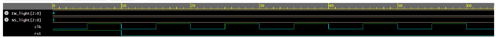

# Mini Project-2 - Traffic Light Controller Using Verilog

## Description
This project implements a Traffic Light Controller using Verilog. The controller manages traffic signals with proper timing and state transitions.

## Modules
- design.sv - Traffic Light Controller design
- testbench.sv - Testbench for verification

## Waveform

